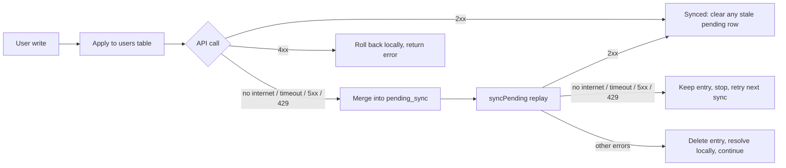

# Sliide — User Management (KMP)

Kotlin Multiplatform app for Android and iOS with 100% shared Compose Multiplatform UI, built on the
[GoRest](https://gorest.co.in) users API.

## Architecture

Clean Architecture (domain / data / presentation) with MVI, Koin for DI and Room KMP as the local cache.

| Module | Holds | Depends on |
|---|---|---|
| `:users:domain` | `User` and sync models, `UserRepository` and `UserApiClient` interfaces | `:core:domain` |
| `:users:data` | `OfflineFirstUserRepository`, `KtorUserApiClient`, `PendingSyncMerger`, DTOs, entity↔domain mappers, Koin module | users domain, `:core:database`, `:core:data` |
| `:users:presentation` | `UsersViewModel` (MVI), `UsersRoot` / `UsersScreen`, strings, Koin module | users domain, `:core:designsystem` |
| `:core:domain` | `Result` / `EmptyResult` / `DataError` and their helpers | — |
| `:core:data` | Ktor `HttpClientFactory`, the `HttpClient` `get` / `post` / `patch` / `delete` extensions, per-platform engine, BuildKonfig GoRest credentials, `ApplicationScope` qualifier | `:core:domain` |
| `:core:database` | Room KMP `SliideDatabase`: `users` and `pending_sync` tables, their DAOs, `DatabaseTransactionRunner`, per-platform builder | — |
| `:core:designsystem` | `SliideTheme`: light/dark Material 3 colour schemes and typography | — |
| `:composeApp` | Shared app shell `App()`, Koin assembly `initKoin(applicationScope)` / `initKoinIos()`, iOS framework `ComposeApp` | everything above |
| `:androidApp` | `SliideApplication` (owns the application `CoroutineScope`, starts Koin), `MainActivity` | `:composeApp` |
| `iosApp` | SwiftUI shell; starts Koin with `initKoinIos()` in `iOSApp.init()` and hosts `MainViewController()` | `ComposeApp` framework |

Why this shape:
- **Feature-first.** With one feature, shared code stays in `:users:*` until a second feature needs it. Only the
  database (so another feature can share the cache), the theme (used by the app shell and every feature), the HTTP
  stack (`:core:data`) and the `Result` / `DataError` types it returns (`:core:domain`, because core can never depend on
  a feature) live in `core`.
- **Presentation never sees data.** `:users:presentation` only knows the domain interface; Koin binds
  `OfflineFirstUserRepository` to it in `:composeApp`.
- **Two `expect`/`actual`s, both genuine platform differences:** the Room database builder (Android needs a `Context`,
  iOS the documents directory) and the Ktor engine (OkHttp on Android, Darwin on iOS). Everything else is in `commonMain`.
- **Convention plugins** in [`build-logic`](./build-logic) (`kmp.library`, `cmp.library`, `cmp.feature`,
  `cmp.application`, `android.application.compose`, `room`, `buildkonfig`) hold targets, SDKs, JVM 17, test source sets, Compose,
  Koin and Room/KSP. Module build files are a plugin alias plus project dependencies. All versions are in
  [`gradle/libs.versions.toml`](./gradle/libs.versions.toml).

### HTTP stack (`:core:data`)

One `HttpClient`, built by `HttpClientFactory` and shared through Koin. The contract is in
[`openspec/changes/add-ktor-api-client`](./openspec/changes/add-ktor-api-client).

- **Credentials at build time.** The `buildkonfig` convention plugin generates an `internal object BuildKonfig` with
  `BASE_URL` (`https://gorest.co.in/public/v2/`) and `API_TOKEN`. The token comes from `GOREST_API_TOKEN` in the
  git-ignored `local.properties`, or from the environment variable of the same name on CI. If neither is set, it is
  empty and Gradle warns: the build and tests still pass, but GoRest writes fail with 401. The token is never in a
  tracked file. It is not encrypted in the app: it ships in the binary, so encrypting it would also mean shipping the
  key. Only a backend proxy could truly hide it, which is out of scope here.
- **Every request** carries `Authorization: Bearer <token>` and `Accept: application/json`. POST and PATCH send JSON
  bodies. Unknown response fields are ignored.
- **Timeouts:** 20 s per request, 10 s to connect, 20 s socket. No request waits longer than one timeout.
- **Routes are relative with no leading slash** (`"users"`, `"users/42"`). A leading `/` would replace the base path
  and drop `/public/v2`.
- **Extensions** `HttpClient.get` (returns the body **and the response headers**, e.g. `X-Pagination-Pages`), `post`,
  `patch` and `delete` (never decodes a body, so `204` succeeds). Each returns `Result<…, DataError.Remote>` and never
  throws, except for cancellation, which always propagates.

How responses and exceptions map to `DataError.Remote`. Retryable errors are queued by the offline-first repository;
the rest are returned to the caller.

| Outcome | `DataError.Remote` | Retryable |
|---|---|---|
| 2xx | success | — |
| 401, 403 | `UNAUTHORIZED` | no |
| 404 | `NOT_FOUND` | no (success for `DELETE`) |
| 408, or a request / connect / socket timeout | `REQUEST_TIMEOUT` | yes |
| 422 | `VALIDATION` | no |
| 429 | `TOO_MANY_REQUESTS` | yes |
| 5xx | `SERVER_ERROR` | yes |
| Any other `IOException` (no connectivity, DNS failure, connection refused; OkHttp and Darwin alike) | `NO_INTERNET` | yes |
| Malformed body | `SERIALIZATION` | no |
| Anything else | `UNKNOWN` | no |

Timeouts are checked before the generic `IOException` case, because Ktor's timeout exceptions are themselves
`IOException`s. Tests with the real engines confirm that a refused connection becomes `NO_INTERNET` on both
platforms. Without that, an offline create on iOS would be discarded instead of queued.

### GoRest users API (`KtorUserApiClient`)

`KtorUserApiClient` implements the domain's `UserApiClient` interface over the HTTP stack:

| Operation | Request | Success |
|---|---|---|
| `fetchLastPage()` | `GET users?page=1&per_page=20`, then `GET users?page=<last>&per_page=20` | 200, list of users |
| `create(details)` | `POST users` | 201, the user with its server id |
| `update(id, details)` | `PATCH users/{id}` | 200, the updated user |
| `delete(id)` | `DELETE users/{id}` | 204 |

**Getting the last page takes two requests.** GoRest has no "last page" query, so `fetchLastPage()`:
1. requests page 1 and reads the total page count from the `X-Pagination-Pages` response header (which is why
   `HttpClient.get` returns headers);
2. requests that page, with the same `per_page=20`.

The second request needs the first's header, so they run strictly one after the other inside the same method. If
either fails, the whole fetch fails with that one error and no partial list. A missing or non-numeric header is a
`SERIALIZATION` failure. When there is only one page (or none), the first response is reused and no second request is
sent. GoRest's public data changes constantly, so the last page can disappear between the two requests. An empty last
page is then returned as an empty list: the feed shows its empty state and the user can refresh.

Users go over the wire with lowercase `gender` (`male` / `female`) and `status` (`active` / `inactive`). Any other value
fails the whole response with `SERIALIZATION`.

### Offline-first sync

Room is the single source of truth for the UI. Every write lands in the local cache first and reaches GoRest when it
can. Writes that can't reach the server wait in an outbox. The full contract is in
[`openspec/changes/add-offline-pending-sync`](./openspec/changes/add-offline-pending-sync).

| Table | Holds |
|---|---|
| `users` | The cached feed. Writes are applied optimistically. A user created offline gets a **negative temporary id**, which can't clash with GoRest's positive ids. |
| `pending_sync` | The outbox: **one row per user**, holding a snapshot of the user and `CREATE`, `UPDATE` or `DELETE`. A merged row keeps its original place in the queue. |



**Which errors keep a write and which delete it.**

| Error | Direct write (user is on screen) | Queued write during replay |
|---|---|---|
| No internet, timeout, 5xx, 429 Too Many Requests | Queued, returns `QUEUED` | **Kept**; replay stops and retries on the next sync |
| 404 on `DELETE` | Success (already gone) | Success, entry deleted |
| 404 on `UPDATE` | User removed locally, error returned | User removed locally, entry deleted |
| 422 on `CREATE` (e.g. email taken) | Rolled back, error returned | Temp user removed, entry deleted |
| 422 / other 4xx on `UPDATE` | Previous data restored, error returned | Local edit kept until next refresh, entry deleted |
| Other 4xx on `DELETE` | User restored, error returned | User restored, entry deleted |

Nothing is recorded for a dropped queued write; `syncPending()` only reports how many were rejected. A user created
offline whose email turns out to be taken therefore just disappears from the list. That is an accepted minor
inconvenience, since direct writes made online still show their error.

**Merge rules.** Several writes to one user collapse into a single queued request
(`PendingSyncMerger`, one pure function):

| Already queued | Then edit | Then delete |
|---|---|---|
| nothing | `UPDATE` | `DELETE` |
| `CREATE` | `CREATE` with the new data | both dropped, no API call ever |
| `UPDATE` | `UPDATE` with the latest data | `DELETE` |

Edits and deletes to a user that has never synced (temporary id) never call the API. They only merge into its
`CREATE`.

**Delete with Undo.** A confirmed delete only removes the user locally. Undo puts the user back without any network
call. The real `DELETE` is sent by `finalizeDelete` once the Snackbar is dismissed, and it is queued if the device is
offline. Sync skips users that are still in their Undo window.

**Replay and refresh.**
- `syncPending()` replays the queue oldest first and stops at the first retryable failure.
- A successful `CREATE` **re-keys** the temporary id to the server id in one transaction.
- When a direct write succeeds online, it clears that user's stale pending row, so old data is never replayed over it.
- `refresh()` **syncs first**. It fetches the last page of `/users` and replaces the cache (only if the page differs)
  only when the queue is empty. Replacing earlier would bring back deleted users and drop unsynced creates.

**Concurrency.**
- A write lock is held **per queue entry**, so a user write waits for at most one in-flight request.
- Sync is **single-flight**: a second caller joins the running pass instead of resending entries.
- Each entry is cleared in its own transaction, so a replay the OS interrupts resumes cleanly.
- Planned follow-up: a background job (Android WorkManager / iOS `BGTaskScheduler`, about every 30 minutes) that
  only calls `syncPending()`.

### Application scope: operations outlive the screen

Each platform's application creates one process-wide `CoroutineScope(SupervisorJob() + Dispatchers.Default)` and
hands it to Koin, which binds it under the `ApplicationScope` qualifier:
- on Android, `SliideApplication` owns it as a property;
- on iOS, `initKoinIos()` creates it, because there is no `Application` object and Swift can't build a Kotlin scope.

It is never cancelled: its lifetime is the process.

Every suspending `OfflineFirstUserRepository` operation runs its body in that scope and the caller only awaits it:
create, update, local remove, restore, finalise delete, sync and refresh. If the caller (a ViewModel being cleared)
is cancelled, only its wait ends. The operation still finishes its local writes, its request and any rollback or
queueing, so the cache, the outbox and the server are never left half-updated. Thanks to the `SupervisorJob`, a failing
operation reports to its own caller without cancelling the others. `observeUsers()` stays a cold flow tied to its
collector.

Because operations now outlive their caller, the crash-safety tests simulate a process kill by cancelling the
application scope itself (a child scope passed to the repository), not by cancelling the caller.

## Running the apps

**First, set the GoRest token.** Add your token (from [gorest.co.in](https://gorest.co.in/consumer/login)) to the
git-ignored `local.properties` at the repo root, then re-sync Gradle:

```properties
GOREST_API_TOKEN=<your token>
```

On CI, set the `GOREST_API_TOKEN` environment variable instead. Without a token, the project still builds and every
test passes, and the feed still loads. But creates, edits and deletes get `401` and are rejected, so set it before you
try to write anything.

- Android: `./gradlew :androidApp:installDebug`, or the run widget in the IDE.
- iOS: open [`iosApp`](./iosApp) in Xcode and run. The build phase calls `:composeApp:embedAndSignAppleFrameworkForXcode`.

## Running tests and checks

- Unit tests (shared `commonTest`, on the JVM): `./gradlew testAndroidHostTest`
- Unit tests on iOS: `./gradlew iosSimulatorArm64Test`
- Instrumented tests (emulator running): `./gradlew :core:database:connectedAndroidDeviceTest :core:data:connectedAndroidDeviceTest :users:data:connectedAndroidDeviceTest :androidApp:connectedDebugAndroidTest`
- Everything: `./gradlew build` and `./gradlew :composeApp:linkDebugFrameworkIosSimulatorArm64`
- Lint: `./gradlew ktlintCheck` (`./gradlew ktlintFormat` fixes most issues)

Tests use kotlin-test, AssertK, Turbine and coroutines-test with fakes rather than mocks. The Koin graph is checked
with `koin-test`'s `verify()` (`KoinGraphTest`), and an instrumented smoke test launches the real app.

---

## How AI is used in this project

The app is built with [Claude Code](https://claude.com/claude-code) as the coding agent. Everything that guides and
checks the agent is committed in this repo, so the setup can be reviewed and reproduced.

### Context: what the agent knows

| Where | What it does |
|---|---|
| [`CLAUDE.md`](./CLAUDE.md) | The brief, fixed stack, module/dependency rules and Definition of Done. Loaded into every session. |
| [`.claude/skills/`](./.claude/skills) | Focused playbooks the agent loads only when a task matches (e.g. `kmp-module-structure`, `android-data-layer`, `android-presentation-mvi`, `android-unit-testing`). Copied from [PL-Coding-GmbH/Skills](https://github.com/PL-Coding-GmbH/Skills). |
| [`.claude/agents/`](./.claude/agents) | Specialised review subagents (bug, convention, security, issue validation, mutation testing, audit) used by the `verify` skill to review a diff before it is committed. |
| [`openspec/`](./openspec) | Spec-driven workflow ([OpenSpec](https://github.com/Fission-AI/OpenSpec)): each feature starts as a proposal → design → tasks (`/opsx:propose`), is implemented against those tasks (`/opsx:apply`) and is checked against the spec (`/opsx:verify`). [`openspec/config.yaml`](./openspec/config.yaml) restates the project rules for every change. |

### Quality gates: what the agent can't skip

Instructions can be ignored, but hooks can't. [`.claude/settings.json`](./.claude/settings.json) wires two
[Claude Code hooks](https://docs.claude.com/en/docs/claude-code/hooks) that enforce quality mechanically:

1. **Lint after every turn** ([`stop-lint.sh`](./.claude/hooks/stop-lint.sh), `Stop` hook). When the agent finishes a
   turn that changed Kotlin files, `./gradlew ktlintCheck` runs. New violations are fed back to the agent, and it has
   to fix them before it can stop. Generated sources under `build/` are excluded and there are no baselines, so every module is held to the rule. After one failed fix attempt the hook warns instead of blocking again, so it
   can't trap the agent in a loop.
2. **Tests before every push** ([`pre-push-tests.sh`](./.claude/hooks/pre-push-tests.sh), `PreToolUse` hook on
   `Bash`). Any command containing `git push` first runs `./gradlew testAndroidHostTest`. If a test fails, the push is
   blocked and the failing tests are reported back to the agent, which must fix the code rather than skip or weaken
   the tests.

Both gates were tested in both directions: a deliberately failing test blocked a push, and badly formatted Kotlin
stopped the turn until it was fixed.

On top of the hooks, the Definition of Done in `CLAUDE.md` requires `./gradlew build` and the iOS framework link
task to pass before any task counts as complete.

### Example: the module setup

The multi-module structure was the first OpenSpec change ([`openspec/changes/setup-module-structure`](./openspec/changes/setup-module-structure)).
The agent asked the clarifying questions first: one `core` module or several, whether to rename `:shared`, and
whether Room lives in data or in core. The answers went into the proposal, specs and design. Then it implemented the
27 tasks group by group, with each group carrying its own tests. Version lookups came straight from Maven Central and
Google Maven. Build failures went back into the loop and were fixed there: a missing JDK 17 toolchain, a JetBrains
test artifact that doesn't exist, and an Espresso incompatibility with API 37. The final check was the app running on
an Android emulator and an iOS simulator in light and dark mode.

### Example: the offline sync database

The outbox design ([`openspec/changes/add-offline-pending-sync`](./openspec/changes/add-offline-pending-sync)) was
planned with OpenSpec, and Claude was asked to challenge the design before writing it. That surfaced gaps the first
description didn't cover:
- users created offline have no server id, which led to temporary ids that are re-keyed after sync;
- a queued edit could overwrite a newer online edit, so a successful write now clears the stale entry;
- a replay running during the Undo window could orphan a user on the server, so Undo-window users are skipped;
- a temporary rate limit (429) would have dropped real writes, so it is retried, and only errors that can never
  succeed delete a queued write.

Implementation ran as parallel Claude agents in dependency waves:
1. database and domain contracts;
2. merge rules and mappers, alongside the test doubles;
3. the repository, alongside the docs.

Each agent owned one set of files, and the orchestrator ticked off tasks and ran the verification gate.

### Example: the Ktor API client

The HTTP layer ([`openspec/changes/add-ktor-api-client`](./openspec/changes/add-ktor-api-client)) was also planned with
OpenSpec. Claude asked about the choices that changed the plan (module placement, page size, who owns the application
scope) and flagged problems that the request didn't mention:
- `Result`/`DataError` lived in a feature module, so a core HTTP module couldn't return them. They moved to `:core:domain`.
- If a connectivity error mapped to the non-retryable `UNKNOWN`, the offline repository would **delete** a user created
  offline instead of queueing it. Tests with the real OkHttp and Darwin engines now pin "connection refused →
  `NO_INTERNET`" on both platforms.
- The app had no `INTERNET` permission.
- The token must never reach git, and encrypting it in the app wouldn't protect it (see the HTTP stack section).

Claude then checked its own tests by temporarily breaking the code: removing the outbox-first enqueue, and running
operations in the caller instead of the application scope. In both cases the reworked crash-safety and new lifetime
tests failed, and passed again once the code was restored.

---

Learn more about [Kotlin Multiplatform](https://www.jetbrains.com/help/kotlin-multiplatform-dev/get-started.html)…