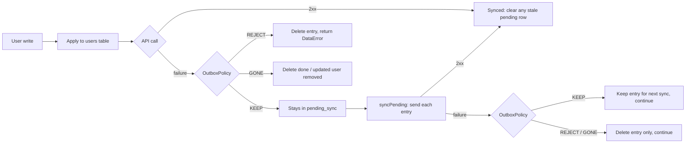

# Sliide — User Management (KMP)

Kotlin Multiplatform app for Android and iOS with 100% shared Compose Multiplatform UI, built on the
[GoRest](https://gorest.co.in) users API.

## Architecture

Clean Architecture (domain / data / presentation) with MVI, Koin for DI and Room KMP as the local cache.

| Module | Holds | Depends on |
|---|---|---|
| `:users:domain` | `User` and sync models, `UserRepository` and `UserApiClient` interfaces, `UserDetailsValidator` | `:core:domain` |
| `:users:data` | `OfflineFirstUserRepository`, `KtorUserApiClient`, `PendingSyncMerger`, DTOs, entity↔domain mappers, Koin module | users domain, `:core:database`, `:core:data` |
| `:users:presentation` | `usersGraph` and its routes (`UsersRoute`, `CreateUserRoute`), `UsersListDetailRoot` (adaptive list-detail), `UsersViewModel` / `ProfileViewModel` (MVI) and their screens, `DeleteUndoController`, relative-time and error-message mapping, strings, Koin module | users domain, `:core:designsystem` |
| `:core:domain` | `Result` / `EmptyResult` / `DataError` and their helpers | — |
| `:core:data` | Ktor `HttpClientFactory`, the `HttpClient` `get` / `post` / `patch` / `delete` extensions, per-platform engine, BuildKonfig GoRest credentials, `ApplicationScope` qualifier | `:core:domain` |
| `:core:database` | Room KMP `SliideDatabase`: `users` and `pending_sync` tables, their DAOs, `DatabaseTransactionRunner`, per-platform builder | — |
| `:core:designsystem` | `SliideTheme` (palette, typography, shape/spacing/motion tokens), shared components (card, avatar, shimmer, segmented toggle, FAB, Undo snackbar, destructive button, banners), `DeviceConfiguration`, `SliideAdaptiveListDetailLayout` | — |
| `:composeApp` | Shared app shell `App()` with the app's one `NavHost` (`NavigationRoot`), Koin assembly `initKoin(applicationScope)` / `initKoinIos()`, iOS framework `ComposeApp` | everything above |
| `:androidApp` | `SliideApplication` (owns the application `CoroutineScope`, starts Koin), `MainActivity` | `:composeApp` |
| `iosApp` | SwiftUI shell; starts Koin with `initKoinIos()` in `iOSApp.init()` and hosts `MainViewController()` | `ComposeApp` framework |

Why this shape:
- **Feature-first.** With one feature, shared code stays in `:users:*` until a second feature needs it. Only the
  database (so another feature can share the cache), the theme (used by the app shell and every feature), the HTTP
  stack (`:core:data`) and the `Result` / `DataError` types it returns (`:core:domain`, because core can never depend on
  a feature) live in `core`.
- **Presentation never sees data.** `:users:presentation` only knows the domain interface; Koin binds
  `OfflineFirstUserRepository` to it in `:composeApp`.
- **Two `expect`/`actual`s, both genuine platform differences:** the Room database builder (Android needs a `Context`,
  iOS the documents directory) and the Ktor engine (OkHttp on Android, Darwin on iOS). Everything else is in `commonMain`.
- **Convention plugins** in [`build-logic`](./build-logic) (`kmp.library`, `cmp.library`, `cmp.feature`,
  `cmp.application`, `android.application.compose`, `room`, `buildkonfig`) hold targets, SDKs, JVM 17, test source sets, Compose,
  Koin and Room/KSP. Module build files are a plugin alias plus project dependencies. All versions are in
  [`gradle/libs.versions.toml`](./gradle/libs.versions.toml).

### HTTP stack (`:core:data`)

One `HttpClient`, built by `HttpClientFactory` and shared through Koin. The contract is in
[`openspec/changes/archive/2026-11-02-add-ktor-api-client`](./openspec/changes/archive/2026-11-02-add-ktor-api-client).

- **Credentials at build time.** The `buildkonfig` convention plugin generates an `internal object BuildKonfig` with
  `BASE_URL` (`https://gorest.co.in/public/v2/`) and `API_TOKEN`. The token comes from `GOREST_API_TOKEN` in the
  git-ignored `local.properties`, or from the environment variable of the same name on CI. If neither is set, it is
  empty and Gradle warns: the build and tests still pass, but GoRest writes fail with 401. The token is never in a
  tracked file. It is not encrypted in the app: it ships in the binary, so encrypting it would also mean shipping the
  key. Only a backend proxy could truly hide it, which is out of scope here.
- **Every request** carries `Authorization: Bearer <token>` and `Accept: application/json`. POST and PATCH send JSON
  bodies. Unknown response fields are ignored.
- **One injected `Json`.** `goRestJson()` holds the decoding rules; Koin binds one instance and passes it to
  `HttpClientFactory.create(engine, json)`, which installs it in `ContentNegotiation` and registers it on the client
  (`HttpClientFactory.JsonKey`) for the size-capped 422 parser. There is no second, global `Json`. Tests build the
  client the same way.
- **Timeouts:** 20 s per request, 10 s to connect, 20 s socket. No request waits longer than one timeout.
- **Routes are relative with no leading slash** (`"users"`, `"users/42"`). A leading `/` would replace the base path
  and drop `/public/v2`.
- **Extensions** `HttpClient.get` (returns the body **and the response headers**, e.g. `X-Pagination-Pages`), `post`,
  `patch` and `delete` (never decodes a body, so `204` succeeds). `get` returns `Result<…, DataError.Remote>`; the
  write helpers return `Result<…, DataError>`, because a 422 carries GoRest's field errors (below). None of them
  throws, except for cancellation, which always propagates.
- **422 on a write** is parsed from GoRest's body (`[{"field": "email", "message": "has already been taken"}]`, the
  same format on every endpoint) into `DataError.Validation(fields)`, keeping fields and messages unchanged and in
  order. A body that is empty, not JSON, not a list, larger than 16 KB (at most that much is read, whatever the headers
  say), or fails to read gives `Validation(emptyList())`, never a serialization error.

How the other responses and exceptions map to `DataError.Remote`. What a failed *write* then means (kept for later,
rejected, already gone) is decided by the users feature, not here.

| Outcome | `DataError.Remote` |
|---|---|
| 2xx | success |
| 401, 403 | `UNAUTHORIZED` |
| 404 | `NOT_FOUND` |
| 408, or a request / connect / socket timeout | `REQUEST_TIMEOUT` |
| 422 on a read (GoRest reads don't return it) | `UNKNOWN` |
| 429 | `TOO_MANY_REQUESTS` |
| 5xx | `SERVER_ERROR` |
| Any other `IOException` (no connectivity, DNS failure, connection refused; OkHttp and Darwin alike) | `NO_INTERNET` |
| Malformed body | `SERIALIZATION` |
| Anything else | `UNKNOWN` |

Timeouts are checked before the generic `IOException` case, because Ktor's timeout exceptions are themselves
`IOException`s. Tests with the real engines confirm that a refused connection becomes `NO_INTERNET` on both
platforms. Without that, an offline create on iOS would be discarded instead of queued.

### GoRest users API (`KtorUserApiClient`)

`KtorUserApiClient` implements the domain's `UserApiClient` interface over the HTTP stack:

| Operation | Request | Success |
|---|---|---|
| `fetchLastPage()` | `GET users?page=1&per_page=20`, then `GET users?page=<last>&per_page=20` | 200, list of users |
| `create(details)` | `POST users` | 201, the user with its server id |
| `update(id, details)` | `PATCH users/{id}` | 200, the updated user |
| `delete(id)` | `DELETE users/{id}` | 204 |

**Getting the last page takes two requests.** GoRest has no "last page" query, so `fetchLastPage()`:
1. requests page 1 and reads the total page count from the `X-Pagination-Pages` response header (which is why
   `HttpClient.get` returns headers);
2. requests that page, with the same `per_page=20`.

The second request needs the first's header, so they run strictly one after the other inside the same method. If
either fails, the whole fetch fails with that one error and no partial list. A missing or non-numeric header is a
`SERIALIZATION` failure. When there is only one page (or none), the first response is reused and no second request is
sent. GoRest's public data changes constantly, so the last page can disappear between the two requests. An empty last
page is then returned as an empty list: the feed shows its empty state and the user can refresh.

Users go over the wire with lowercase `gender` (`male` / `female`) and `status` (`active` / `inactive`). Any other value
fails the whole response with `SERIALIZATION`.

**Write errors.** `create`, `update` and `delete` pass the HTTP stack's `DataError` through unchanged:
`Validation(fields)` for a 422, `Remote.NOT_FOUND` for a 404, and the table above for everything else. A
`Validation` on a `DELETE` means GoRest refused it (it does so while fewer than 100 seeded records remain); every
consumer already knows which operation failed, so there is no separate type for it. The app never interprets the
message text: the profile shows it as "<Field> <message>", e.g. "Email has already been taken".

### Offline-first sync

Room is the single source of truth for the UI. Every write lands in the local cache first and reaches GoRest when it
can. Writes that can't reach the server wait in an outbox. The full contract is in
[`openspec/changes/archive/2026-11-02-add-offline-pending-sync`](./openspec/changes/archive/2026-11-02-add-offline-pending-sync).

| Table | Holds |
|---|---|
| `users` | The cached feed. Writes are applied optimistically. A user created offline gets a **negative temporary id**, which can't clash with GoRest's positive ids. |
| `pending_sync` | The outbox: **one row per user**, holding a snapshot of the user and `CREATE`, `UPDATE` or `DELETE`. A merged row keeps its original place in the queue. |



**Writes are queued only on failure.** A create, edit or delete is written to the cache and sent straight away; only a
failed request that is worth retrying writes (or merges into) the user's pending entry. A successful write never
touches the queue, apart from clearing an older entry it supersedes. A write cut off by a killed process is lost, and
the next refresh shows the server's data; that is accepted as too rare to cover (the user can make the change again).

**One policy decides what happens to a failed write.** `OutboxPolicy.decide(operation, error)` is a pure function
used by both the direct write and the replay, so the two paths can never disagree (a parity test runs the same
failures through both). Every `when` in it is exhaustive with no `else`, so a new error value doesn't compile until
it is classified, and one test covers every cell:

| `DataError` | `CREATE` | `UPDATE` | `DELETE` |
|---|---|---|---|
| `Remote`: no internet, timeout, 5xx, 429, **401/403** | KEEP | KEEP | KEEP |
| `Remote`: malformed body, any other status (e.g. 400) | REJECT | REJECT | REJECT |
| `Validation` (422; on a delete, GoRest refusing it) | REJECT | REJECT | REJECT |
| `Remote.NOT_FOUND` (404) | REJECT | GONE | GONE |
| `Local` | REJECT | REJECT | REJECT |

The repository then applies the decision with what each path knows:

| Decision | Direct write (user is on screen) | Queued write during replay |
|---|---|---|
| KEEP | Entry queued; returns `QUEUED`, or `QUEUED_AUTH_FAILED` for 401/403 | Entry kept for the next sync; the other entries are still sent |
| REJECT | Entry deleted; a create also removes its temp user (the form stays open for a corrected resubmit). Returns the `DataError` | Entry deleted only; counted as rejected |
| GONE | Delete: success. Update: user removed locally, returns `NOT_FOUND` | Entry deleted only; a delete counts as synced, an update as rejected |

**401 and 403 are kept, not dropped.** A bad or expired build token would otherwise silently throw away every offline
edit. Instead the write stays queued and the UI says "Couldn't authenticate, will retry" rather than "Saved offline".
A build with a valid token drains the queue. Reads are unaffected: a refresh still reports the unauthorised error.

Neither path rolls the cached users back (except a rejected direct create, whose temp user goes at once). When a write
is rejected, only its pending entry is deleted, and the next refresh replaces the cached list with the server's: a
rejected edit is undone then, a user created offline whose email turns out to be taken disappears, and a user whose
delete was refused comes back. Nothing is recorded for a dropped queued write;
`syncPending()` only reports how many were rejected. That is an accepted minor inconvenience, since direct writes made
online still show their error.

**Merge rules.** Several writes to one user collapse into a single queued request
(`PendingSyncMerger`, one pure function):

| Already queued | Then edit | Then delete |
|---|---|---|
| nothing | `UPDATE` | `DELETE` |
| `CREATE` | `CREATE` with the new data | both dropped, no API call ever |
| `UPDATE` | `UPDATE` with the latest data | `DELETE` |

Edits and deletes to a user that has never synced (temporary id) never call the API. They only merge into its
`CREATE`.

**Delete with Undo.** A confirmed delete only removes the user locally. Undo puts the user back without any network
call. The real `DELETE` is sent by `finalizeDelete` once the Snackbar is dismissed, and it is queued if the device is
offline. Sync skips users that are still in their Undo window.

**Replay and refresh.**
- `syncPending()` sends the queue oldest first, one loop with no per-entry outcome type: a success clears the entry, a
  failure the policy keeps leaves the entry for the next sync, anything else deletes the entry. Every queued write is sent
  once per sync; the pass never stops early and never retries.
- A successful `CREATE` **re-keys** the temporary id to the server id in one transaction.
- When a direct write succeeds online, it clears that user's stale pending row, so old data is never replayed over it.
- `refresh()` **syncs first**. It fetches the last page of `/users` and replaces the cache (only if the page differs)
  only when the queue is empty. Replacing earlier would bring back deleted users and drop unsynced creates.

**Concurrency.**
- A write lock is held **per queue entry**, so a user write waits for at most one in-flight request.
- Sync is **single-flight**: a second caller joins the running pass instead of resending entries.
- Each entry is cleared in its own transaction, so a replay the OS interrupts resumes cleanly.

### Background sync

The planning artifacts are in [`openspec/changes/archive/2026-11-02-add-background-sync`](./openspec/changes/archive/2026-11-02-add-background-sync).

The queue is also replayed while the app isn't in the foreground, so a change saved offline reaches GoRest even if the
user never reopens the app. A background run calls **only `syncPending()`** (or `syncPending(userId)`), never
`refresh()`, so a row never disappears from a list the user is looking at.

Two triggers, both visible in code (per-user sync: [`openspec/changes/sync-per-operation`](./openspec/changes/sync-per-operation)):

1. **Per write.** When `OfflineFirstUserRepository` queues a write (a failed create, update or delete it keeps for
   later), it calls `UserSyncScheduler.requestSync(userId)` right after the queuing transaction commits. A write that
   succeeds, is rejected, or cancels out (offline create then delete) requests nothing.
2. **Periodic safety net.** `initKoin()` calls `schedulePeriodicSync()` once per launch. It replays whatever is left,
   e.g. a write whose process died before its request went out.

Both replay paths share one `replayEntry(userId)` in the repository: it takes the write lock and re-reads the entry, so
a per-user sync, a periodic run and a pull-to-refresh never send the same entry twice.

| | Android | iOS |
|---|---|---|
| Mechanism | WorkManager unique periodic work `sync_pending_users`, every 30 min | `BGAppRefreshTask` `com.androidlearning.sliide.sync-pending-users`, not before 30 min |
| Per-write request | unique one-time work `sync_user_<id>` with `REPLACE`, replaying only that user's entry as soon as the device is online | iOS has no per-item task: `requestSync` makes sure one app-refresh request is pending, and its run replays the whole queue |
| Offline | `NetworkType.CONNECTED`: the OS doesn't start the job | an `NWPathMonitor` check at the start of the run; offline → completes without syncing |
| Scheduling | on every launch with `KEEP`, so the period never restarts and a running sync is never cancelled | registered at launch; a request is submitted only if none is pending, and each run submits the next one first |
| Time limit | none in practice | about 30 s; on expiry the run is cancelled and the remaining entries wait for the next run |

- **No retry.** Every run reports success to the OS (on iOS, expiry reports failure, as Apple requires), so there is
  no backoff, for periodic and per-user work alike. Whatever is still queued waits for the next request, periodic run
  or foreground refresh.
- **Why `REPLACE` per user.** With `KEEP`, a write merged into an entry while that user's job is running would wait
  for the periodic run. `REPLACE` cancels only the running job's wait: the send runs in the application scope and
  completes, and the new job re-reads and sends whatever is left. One user's failing entry never stops
  another user's job; replays share the repository's write lock, so a slow request delays the next one by at most its
  20 s timeout.
- **Shared logic.** `BackgroundUserSync` (`commonMain`) is the run itself. The Android `UserSyncWorker` and the iOS
  `IosBackgroundSyncRunner` only adapt the OS callback to it. `UserSyncScheduler` is a domain interface, and
  `platformUserSyncModule` is the only `expect`/`actual`, because WorkManager and `BGTaskScheduler` are unrelated OS
  facilities.
- **Wiring.** The repository takes the `UserSyncScheduler` from Koin. On iOS the scheduler resolves
  `BackgroundUserSync` lazily, on its first background task, because `BackgroundUserSync` → repository → scheduler
  would otherwise be a dependency cycle. `initKoin()` calls `schedulePeriodicSync()` on both platforms. On Android, the manifest removes the
  default WorkManager initializer and `SliideApplication` installs Koin's `workManagerFactory()`, so the worker gets
  its dependencies injected. On iOS, `Info.plist` lists the task id and the `fetch` background mode, and registration
  happens inside `iOSApp.init()`, before launch finishes.
- **Limits.** The OS decides when a run actually starts. On iOS that can be much later than 30 minutes, or not at all
  under Low Power Mode or with Background App Refresh off. Force-quitting the app stops background work on both
  platforms. `BGTaskScheduler` is not available on the iOS Simulator: the app logs "Background sync not scheduled" and
  carries on.

### Application scope: operations outlive the screen

Each platform's application creates one process-wide `CoroutineScope(SupervisorJob() + Dispatchers.Default)` and
hands it to Koin, which binds it under the `ApplicationScope` qualifier:
- on Android, `SliideApplication` owns it as a property;
- on iOS, `initKoinIos()` creates it, because there is no `Application` object and Swift can't build a Kotlin scope.

It is never cancelled: its lifetime is the process.

Every suspending `OfflineFirstUserRepository` operation runs its body in that scope and the caller only awaits it:
create, update, local remove, restore, finalise delete, sync and refresh. If the caller (a ViewModel being cleared)
is cancelled, only its wait ends. The operation still finishes its local writes, its request and any rollback or
queueing, so the cache, the outbox and the server are never left half-updated. Thanks to the `SupervisorJob`, a failing
operation reports to its own caller without cancelling the others. `observeUsers()` stays a cold flow tied to its
collector.

Because operations now outlive their caller, the crash-safety tests simulate a process kill by cancelling the
application scope itself (a child scope passed to the repository), not by cancelling the caller.


### UI: feed, profile, delete with Undo

The planning artifacts are in [`openspec/changes/archive/2026-11-02-build-users-ui`](./openspec/changes/archive/2026-11-02-build-users-ui).

**The cache is the only data source.** `UsersViewModel` builds its state from one `combine`: `observeUsers()`, a
one-minute ticker that recomputes the relative "Added 5 minutes ago" labels, the open Undo window, and the refresh
status. A refresh never writes to the screen state directly; its results arrive only through the cache. The feed
shows:
- **20 lazily built shimmer cards** while the cache is empty and the first refresh is still running;
- a **full-screen error** with Retry when the refresh failed and nothing is cached;
- a slim, dismissible **banner** ("No internet connection") above the cached list when there is data to show;
- an **empty state** ("No users yet") with Retry when the refresh succeeded but returned no users.

**The pull indicator means "you pulled".** The ViewModel records what started each refresh (launch, pull or Retry),
and only a pull shows the pull-to-refresh spinner. The automatic refresh on launch is silent: an empty cache shows the
shimmer, and cached cards appear with no spinner. A Retry from a full-screen state shows the shimmer. A pull while the
launch refresh is still running shows the spinner until that refresh ends, without starting a second one.

**A NavHost for screens, ViewModel state for panes.** `:composeApp` owns the app's one `NavHost` (`NavigationRoot`),
and the users feature adds its graph with `usersGraph(navController)` (type-safe `@Serializable` routes, as in the
`android-navigation` skill). The graph has two destinations:
- **`UsersRoute`**: the feed *and* the open profile. They are one destination because on a wide window both are on
  screen at once, and a `NavHost` shows one destination at a time.
- **`CreateUserRoute`**: the "New user" form, full screen at every window size. Its `ProfileViewModel` belongs to the
  destination, so every visit starts empty. On save it leaves the `WriteStatus` on the feed's back-stack entry
  (`savedStateHandle`, by name), and the feed scrolls to the new user at the top and shows "saved offline" if the create
  was queued.

Inside `UsersRoute`, `UsersListDetailRoot` lays the feed and the profile out with `SliideAdaptiveListDetailLayout` from
`:core:designsystem`. It is a hand-written layout driven by `DeviceConfiguration`, the five-bucket window classification
from the `compose-adaptive-layouts` skill:
- **phone held upright** (under 600dp): one pane. The profile slides in over the feed, and back slides it away again,
  with the feed's scroll position kept;
- **anything wider** (a phone on its side, tablets, desktop): the feed on the start side, 40% of the width clamped to
  280–400dp, and the profile beside it, with the selected card highlighted. Until you pick a user, the detail pane shows
  the **first user in the feed** (`defaultSelectedUserId`). It follows the first card after a delete, Undo, create or
  refresh. The default isn't a choice, so shrinking the window shows the plain list, and back still leaves the app.
  Once you start editing it, it becomes the chosen user, so the draft survives a resize.

Which profile is open is plain ViewModel state: `UsersViewModel` keeps the chosen user id, saves it in its
`SavedStateHandle` so it survives process death, and derives the default from the pane layout the root reports. That
makes the whole selection rule unit-testable, with no navigator to fake. Back on a phone is a Compose `BackHandler` that
closes the profile; the profile's own Edit-mode handler is deeper, so it wins while editing.

The feed's app bar is **pinned**: a single-line `TopAppBar` with `pinnedScrollBehavior`. It never collapses or moves;
it only tints while the lazily built list scrolls beneath it.

**One reusable profile.** `ProfileViewModel` serves three modes. The detail pane has one instance, pointed at a new
user with `OnOpen(key)`; the add-user destination gets a fresh one each visit:
- **View:** the Edit icon sits at the top right.
- **Edit:** the icon animates into a large, filled **Save** button, and a close icon discards the draft.
- **Create:** the add-user FAB navigates to a blank, full-screen form titled "New user", with a back arrow in every
  layout.

It also handles:
- **Validation:** `UserDetailsValidator` is shared domain logic and runs as you type.
- **Process death:** the target, mode and draft are kept in `SavedStateHandle`.
- **Pane closed:** an `OnDismiss` resets the ViewModel, so the next open starts clean.
- **User removed from the cache:** the profile closes. It does so silently when the user was a pending offline user
  that has just received its server id.

**The Undo window outlives every screen.** A confirmed delete removes the user locally at once. `DeleteUndoController`
is an app-wide Koin singleton with its own long-lived scope. It owns the 5-second window and guarantees every delete
ends exactly once:
- either with `restoreUser`, when the user presses Undo;
- or with `finalizeDelete`, when the timer runs out, the snackbar is swiped away, or a newer delete starts.

The confirmation dialog, shared by the feed's long-press and the profile's Delete button, has a close icon at the top
start, a large bin icon, and one full-width destructive **Delete** button. That is the same `DestructiveButton` the
profile uses. There is no separate Cancel button; the close icon, back or an outside tap dismiss it.

Its timer was not put in `viewModelScope`, because if the activity finished during the window, the delete would never
be finalised and `refresh` would stay blocked. The snackbar is a normal `SnackbarHost` on the feed, driven by the
controller's state, with a countdown line that resumes after rotation.

**Where composables live.** Root and Screen composables stay next to their ViewModel, State and Action types
(`users/`, `profile/`, `listdetail/`, `navigation/`). Every smaller composable of the feature lives in one package,
`users/presentation/.../composables`: the card, the feed and its placeholders (one shared lazy layout), the delete
dialog, the select-user placeholder, the shared app bar and back/close icon button, the profile top bar, Save button,
header and form, and the snackbar host. Each one ships its own previews. Generic building blocks stay in
`:core:designsystem` until a second feature needs a feature-level piece.

**Design system.** All of this lives in `:core:designsystem`:
- **Palette:** deep ink neutrals, a midnight primary, one restrained champagne accent, and a refined red used only for
  destructive actions, in matching light and dark schemes.
- **Cards:** separated from the background by tone and a hairline border, not by shadows.
- **Tokens:** shared shape, spacing and motion values.
- **`ContrastTest`:** computes the WCAG ratio for every foreground/background pair the app uses and fails the build
  below AA.

**Deviations from the brief.** These were agreed during planning:
- **"Added …" instead of "Last synced …":** the cache records when it first saw a user, not when that user was last
  synced.
- **Removed locally on confirm:** the row disappears as soon as the delete is confirmed, and the network `DELETE` is
  sent when the Undo window ends, rather than waiting for the 204. This keeps Undo instant and works offline.
- **An extra Status toggle (Active / Inactive):** GoRest requires a status when a user is created.
- **A back arrow before "Profile" on full-screen profiles:** iOS has no system back button.

### App branding & splash

The planning artifacts are in [`openspec/changes/native-splash`](./openspec/changes/native-splash).

**The logo mark.** The mark is a rounded-stroke champagne "S" on midnight. It is defined once, as Bézier constants on
the 108×108 adaptive-icon grid, in
[`tools/brand/generate_brand_assets.py`](./tools/brand/generate_brand_assets.py). That script writes the Android vector
`ic_logo_mark.xml` and the iOS PNGs (`LaunchLogo`, plus `AppIcon` in light, dark and tinted), and fails if the mark drops
below 3:1 contrast against either splash background. The outputs are committed, so neither build depends on Python.

**Native splash on both platforms, no Compose splash.** The launch screen appears before any Kotlin runs, so it is
platform-owned and needs no `expect`/`actual`. A Compose splash would only show after the system one, so the user would
see two.
- **Android:** the AndroidX SplashScreen API (back-ported to API 26–30). `MainActivity` launches with
  `Theme.Sliide.Starting` (the mark on `splash_background`: Midnight, or Ink900 at night), and `installSplashScreen()`
  then switches it to `Theme.Sliide`. That theme's window background is the in-app background, so no white frame
  appears before Compose draws, which also fixes a white flash in dark mode. `SplashThemeTest` checks the switch.
  The launcher icon is an adaptive icon (`mipmap-anydpi`) with the mark as its foreground and as a monochrome layer
  for themed icons.
- **iOS:** a `UILaunchScreen` dictionary in `Info.plist` (`LaunchLogo` on the `LaunchBackground` colour set, which has
  a dark variant) replaces Xcode's generated empty launch screen. There is no storyboard.

**The splash goes away on the first frame.** It is not held while data loads: Room is the source of truth, so the
first frame already shows the cached feed or the shimmer.

iOS caches launch screens. To see a change on a simulator, delete the app first.

## Running the apps

**First, set the GoRest token.** Add your token (from [gorest.co.in](https://gorest.co.in/consumer/login)) to the
git-ignored `local.properties` at the repo root, then re-sync Gradle:

```properties
GOREST_API_TOKEN=<your token>
```

On CI, set the `GOREST_API_TOKEN` environment variable instead. Without a token, the project still builds and every
test passes, and the feed still loads. But creates, edits and deletes get `401`: they stay queued and the app says
"Couldn't authenticate, will retry", so set it before you try to write anything.

- Android: `./gradlew :androidApp:installDebug`, or the run widget in the IDE.
- iOS: open [`iosApp`](./iosApp) in Xcode and run. The build phase calls `:composeApp:embedAndSignAppleFrameworkForXcode`.

## Running tests and checks

- Unit tests (shared `commonTest`, on the JVM): `./gradlew testAndroidHostTest`
- Unit tests on iOS: `./gradlew iosSimulatorArm64Test`
- Instrumented tests (emulator running): `./gradlew :core:database:connectedAndroidDeviceTest :core:data:connectedAndroidDeviceTest :users:data:connectedAndroidDeviceTest :users:presentation:connectedAndroidDeviceTest :androidApp:connectedDebugAndroidTest`
- Everything: `./gradlew build` and `./gradlew :composeApp:linkDebugFrameworkIosSimulatorArm64`
- Lint: `./gradlew ktlintCheck` (`./gradlew ktlintFormat` fixes most issues)

Tests use kotlin-test, AssertK, Turbine and coroutines-test with fakes rather than mocks. The Koin graph is checked
with `koin-test`'s `verify()` (`KoinGraphTest`), and an instrumented smoke test launches the real app.

---

## How AI is used in this project

The app is built with [Claude Code](https://claude.com/claude-code) as the coding agent. Everything that guides and
checks the agent is committed in this repo, so the setup can be reviewed and reproduced.

### Context: what the agent knows

| Where | What it does |
|---|---|
| [`CLAUDE.md`](./CLAUDE.md) | The brief, fixed stack, module/dependency rules and Definition of Done. Loaded into every session. |
| [`.claude/skills/`](./.claude/skills) | Focused playbooks the agent loads only when a task matches (e.g. `kmp-module-structure`, `android-data-layer`, `android-presentation-mvi`, `android-unit-testing`). Copied from [PL-Coding-GmbH/Skills](https://github.com/PL-Coding-GmbH/Skills). |
| [`.claude/agents/`](./.claude/agents) | Specialised review subagents (bug, convention, security, issue validation, mutation testing, audit) used by the `verify` skill to review a diff before it is committed. |
| [`openspec/`](./openspec) | Spec-driven workflow ([OpenSpec](https://github.com/Fission-AI/OpenSpec)): each feature starts as a proposal → design → tasks (`/opsx:propose`), is implemented against those tasks (`/opsx:apply`) and is checked against the spec (`/opsx:verify`). [`openspec/config.yaml`](./openspec/config.yaml) restates the project rules for every change. |

### Quality gates: what the agent can't skip

Instructions can be ignored, but hooks can't. [`.claude/settings.json`](./.claude/settings.json) wires two
[Claude Code hooks](https://docs.claude.com/en/docs/claude-code/hooks) that enforce quality mechanically:

1. **Lint after every turn** ([`stop-lint.sh`](./.claude/hooks/stop-lint.sh), `Stop` hook). When the agent finishes a
   turn that changed Kotlin files, `./gradlew ktlintCheck` runs. New violations are fed back to the agent, and it has
   to fix them before it can stop. Generated sources under `build/` are excluded and there are no baselines, so every module is held to the rule. After one failed fix attempt the hook warns instead of blocking again, so it
   can't trap the agent in a loop.
2. **Tests before every push** ([`pre-push-tests.sh`](./.claude/hooks/pre-push-tests.sh), `PreToolUse` hook on
   `Bash`). Any command containing `git push` first runs `./gradlew testAndroidHostTest`. If a test fails, the push is
   blocked and the failing tests are reported back to the agent, which must fix the code rather than skip or weaken
   the tests.

Both gates were tested in both directions: a deliberately failing test blocked a push, and badly formatted Kotlin
stopped the turn until it was fixed.

On top of the hooks, the Definition of Done in `CLAUDE.md` requires `./gradlew build` and the iOS framework link
task to pass before any task counts as complete.

### Example: the module setup

The multi-module structure was the first OpenSpec change ([`openspec/changes/setup-module-structure`](./openspec/changes/setup-module-structure)).
The agent asked the clarifying questions first: one `core` module or several, whether to rename `:shared`, and
whether Room lives in data or in core. The answers went into the proposal, specs and design. Then it implemented the
27 tasks group by group, with each group carrying its own tests. Version lookups came straight from Maven Central and
Google Maven. Build failures went back into the loop and were fixed there: a missing JDK 17 toolchain, a JetBrains
test artifact that doesn't exist, and an Espresso incompatibility with API 37. The final check was the app running on
an Android emulator and an iOS simulator in light and dark mode.

### Example: the offline sync database

The outbox design ([`openspec/changes/archive/2026-11-02-add-offline-pending-sync`](./openspec/changes/archive/2026-11-02-add-offline-pending-sync)) was
planned with OpenSpec, and Claude was asked to challenge the design before writing it. That surfaced gaps the first
description didn't cover:
- users created offline have no server id, which led to temporary ids that are re-keyed after sync;
- a queued edit could overwrite a newer online edit, so a successful write now clears the stale entry;
- a replay running during the Undo window could orphan a user on the server, so Undo-window users are skipped;
- a temporary rate limit (429) would have dropped real writes, so it is retried, and only errors that can never
  succeed delete a queued write.

Implementation ran as parallel Claude agents in dependency waves:
1. database and domain contracts;
2. merge rules and mappers, alongside the test doubles;
3. the repository, alongside the docs.

Each agent owned one set of files, and the orchestrator ticked off tasks and ran the verification gate.

### Example: the Ktor API client

The HTTP layer ([`openspec/changes/archive/2026-11-02-add-ktor-api-client`](./openspec/changes/archive/2026-11-02-add-ktor-api-client)) was also planned with
OpenSpec. Claude asked about the choices that changed the plan (module placement, page size, who owns the application
scope) and flagged problems that the request didn't mention:
- `Result`/`DataError` lived in a feature module, so a core HTTP module couldn't return them. They moved to `:core:domain`.
- If a connectivity error mapped to the non-retryable `UNKNOWN`, the offline repository would **delete** a user created
  offline instead of queueing it. Tests with the real OkHttp and Darwin engines now pin "connection refused →
  `NO_INTERNET`" on both platforms.
- The app had no `INTERNET` permission.
- The token must never reach git, and encrypting it in the app wouldn't protect it (see the HTTP stack section).

Claude then checked its own tests by temporarily breaking the code: removing the outbox-first enqueue, and running
operations in the caller instead of the application scope. In both cases the reworked crash-safety and new lifetime
tests failed, and passed again once the code was restored.


### Example: the users UI

The UI ([`openspec/changes/archive/2026-11-02-build-users-ui`](./openspec/changes/archive/2026-11-02-build-users-ui)) went from a free-form request to
OpenSpec artifacts. Before planning, Claude asked about the four points that would change the plan:
- the "last synced" field, which the model doesn't have;
- the shape of the Undo bar;
- whether add-user belongs in this change;
- whether the ViewModel should start calling `refresh()`.

It also pushed back on details in the request. Long-press is hard to discover, so cards also get a "Delete"
accessibility action. iOS needs a back arrow, since it has no system back button. The status toggle was added because
GoRest requires a status.

During implementation it drove the emulators over `adb` to check:
- the compact, medium and expanded layouts;
- that a draft survives resizing from tablet to phone;
- light and dark mode;
- create, edit, delete and Undo while **offline**. A user that has never synced never reaches the server, so live
  GoRest data stays untouched.

That pass found a real bug: closing the profile pane didn't reset its ViewModel, so the Create form reopened with the
old draft. The fix (`ProfileAction.OnDismiss`) came with regression tests. It also caught two visual issues, an
untinted gap between the panes and a selection tint that matched one of the avatar tones, and verified their fixes.

### Example: UI polish

The polish pass ([`openspec/changes/archive/2026-11-02-polish-users-ui`](./openspec/changes/archive/2026-11-02-polish-users-ui)) started as a list of UI
complaints: a moving app bar, an empty tablet detail pane, a close icon on a screen that slides in, a small Save
button, a two-button delete dialog, and composables scattered across packages. Before planning, Claude asked two
questions whose answers changed the scope: should design-system components move too (no, feature only), and how big
the Save button should be (a bigger filled button in the app bar). While planning, it found a spec conflict. The
existing "profile closes when its user disappears" rule would show a false "no longer available" message when the
default-selected user is deleted, so it added a scenario for a silent re-target. It also put the default selection
in the ViewModel, so the rule is unit-tested rather than buried in a composable.

During implementation it drove the tablet emulator over `adb`:
- the first user selected in landscape;
- an edit on that default surviving a rotation to portrait;
- deleting the default re-targeting to the next user with no message, then Undo inside the window, so no live GoRest
  user was deleted;
- the new dialog and the Create back arrow.

It also found that `ObserveAsEvents` keeps the callbacks from the first composition, so the root reads the
"showing the default" flag through `rememberUpdatedState`.

### Example: background sync

The background sync ([`openspec/changes/archive/2026-11-02-add-background-sync`](./openspec/changes/archive/2026-11-02-add-background-sync)) started as a
request to "implement the online create, update and delete, queue them on error, and add WorkManager and the iOS
background task". Before planning, Claude read the code and reported that the online writes, their queueing and their
UI wiring already existed, so the change covers only the background job. It asked one question, whether *every* error
should be queued, because a 422 or 401 would fail on every replay. The answer, "no retry, and don't bother when
offline", became two design decisions: queue retryable failures only, and run the job only when there is a network,
without ever retrying.

It also departed from the `android-background` skill's sample where the project needed something else: `KEEP`
instead of `REPLACE`, because scheduling happens on every launch, and an `NWPathMonitor` check on iOS, because an
app-refresh request can't require a network. During implementation, a failing test showed that `advanceUntilIdle()`
doesn't drain `backgroundScope` work, so the iOS runner tests step with `runCurrent()`. Checking on the emulator
showed that `adb shell cmd jobscheduler run -f` can't start periodic work early, because WorkManager skips a run that
arrives before its period. The end-to-end check therefore waits for the real 30-minute period.

### Example: per-user background sync

The per-user sync ([`openspec/changes/sync-per-operation`](./openspec/changes/sync-per-operation)) came from asking
where a failed write gets retried: the answer was "a periodic job scheduled at launch", which was hard to find from the
repository and left an offline write waiting up to 30 minutes after the network came back. Claude drafted the
proposal, delta specs, design and tasks with OpenSpec, then implemented them task by task.

Two corrections came from implementation rather than planning. First, the draft also stopped a full replay on
connection-level failures; while working on it, Claude found that the unarchived `typed-user-errors` change had
deliberately chosen "carry on past every kept failure", with tests asserting it, so it paused and the stop rule was
dropped instead of silently reversing that decision. Second, a draft scenario said a rejected single-user replay
removes the temporary user, but the merged spec leaves the cache to the next refresh; the scenario was corrected to
match. Wiring the scheduler into the repository also exposed an iOS-only Koin cycle, fixed by resolving the run lazily.

### Example: typed write errors

The profile used to guess that every 422 meant "This email may already be in use", and the rule for what happens to a
failed write was written four times in the repository on top of a yes/no `isRetryable` flag. The change
([`openspec/changes/archive/2026-11-02-typed-user-errors`](./openspec/changes/archive/2026-11-02-typed-user-errors)) was explored with Claude against GoRest's
own API notes: a 422 body names the field and the reason, a `DELETE` can be refused with 422 when too few seeded records
remain, and GoRest resets its data every few hours, so a 404 on a cached id is routine.

Claude's first implementation added a feature-level `UserError` type with its own classifier. Reviewing it, the
developer asked why that didn't just reuse the HTTP stack's existing status mapping. Claude explained what the extra
type carried (the parsed field list, the per-operation meaning of 422) and offered to fold it into `DataError`. Before
committing to a shape, it ran ktlint against a probe file and found that turning `DataError.Remote` into a sealed
interface would force every value to be renamed. So the final design keeps the `Remote` enum untouched and adds a
single `DataError.Validation(fields)` beside it. Claude updated the OpenSpec proposal, design, spec deltas and tasks
first, unticked every task whose behaviour had changed, then re-implemented bottom-up. Throughout, the message text
stays uninterpreted (no matching on "taken"), every keep/reject decision lives in one pure `OutboxPolicy` table, and
the tests that asserted "401 rolls back" were rewritten to the new spec rather than deleted.

### Example: native splash

The splash ([`openspec/changes/native-splash`](./openspec/changes/native-splash)) started as "a splash with a logo on
Android and iOS". The repo had no logo, only template launcher icons. Claude proposed an original mark in the existing
palette, and the developer redirected it to the platforms' native splash APIs before any code was written. Claude then
planned the change with OpenSpec. The plan has one geometry source for every asset, a contrast check, and an
instrumented test for the theme switch. Claude confirmed that test is meaningful by deleting `installSplashScreen()`
and watching it fail.

The visual checks were automated on emulators and the simulator. A screenshot loop was too slow to catch a splash
lasting under a second, so Claude recorded each cold start (`adb shell screenrecord`, `xcrun simctl io recordVideo`)
and sampled the frame colours. That confirmed the light and dark backgrounds, the centred mark, and a hand-off with no
white frame on API 37, API 30 and iOS.

### Example: NavHost and the hand-written list-detail

This change started as a question: how does another take on the challenge mix a `NavHost` with two panes on screen at
once? Claude read that project and explained the trick: the panes are a single destination, switched by ViewModel state.
It recommended keeping Material's `ListDetailPaneScaffold`. The developer preferred the other structure, so Claude
ported it: a `NavHost` in `:composeApp`, a full-screen add-user route, selection moved into `UsersViewModel` (saved
for process death), a five-bucket `DeviceConfiguration` and a hand-written `SliideAdaptiveListDetailLayout`. Edit stays
inline in the profile pane.

Checking it on an emulator resized to phone sizes found two bugs that only exist once the feed can leave composition
(while the add-user screen is open). After more than five seconds away the feed's `WhileSubscribed` state restarted
from "loading", which wiped the open profile and lost the default selection. Then the "scroll to the new user" event
fired before the new card arrived, so the list kept its place below it. Claude fixed both: the feed resumes from the
last list it had, and the scroll became state applied with `requestScrollToItem` once the new user is the first card.
The first regression test passed even without the fix, because the fake repository replays its list synchronously.
Claude gave the fake Room's asynchronous first emission and confirmed the test then fails without the fix. Test users
were created offline and deleted before they could sync, so live GoRest data was never touched.

---

Learn more about [Kotlin Multiplatform](https://www.jetbrains.com/help/kotlin-multiplatform-dev/get-started.html)…
